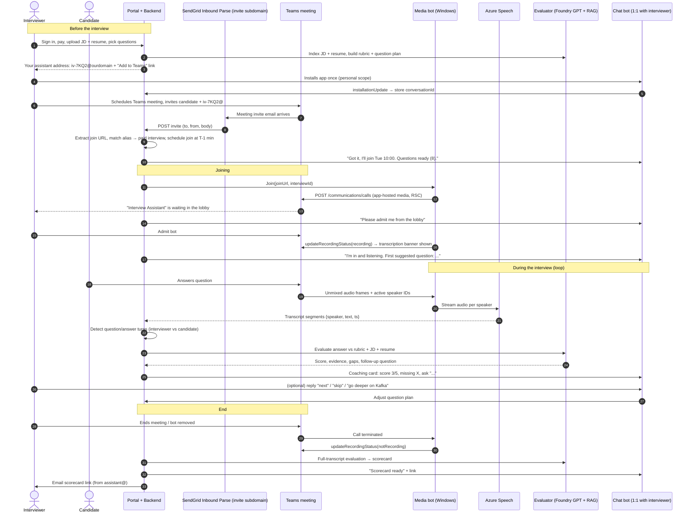

# End-to-End Flow: From Invite to Scorecard

> **Status (2026-11-19):** the live-audio path in this flow (our own Teams media bot, Azure Speech) was replaced by Recall.ai (see [recall-integration.md](recall-integration.md)). The invite intake, the coaching loop and the interviewer-facing parts below still describe the design.

_Assumes Option A works: our own Graph calling bot joins and receives audio. See [bot-join-research.md](bot-join-research.md)._

## Key design point: one Teams app does three jobs

We ship **one Teams app** (one Entra app ID, one Azure Bot) with three capabilities:

| Capability | Manifest | Used for |
|---|---|---|
| **Calling bot** | `bots[0].supportsCalling: true` + RSC `Calls.JoinGroupCalls.Chat`, `Calls.AccessMedia.Chat` | Joins the interview, receives audio |
| **Personal chat bot** | `bots[0].scopes: ["personal", "groupChat"]` | 1:1 private chat with the interviewer (the "second window") |
| **Meeting side panel** (optional) | `configurableTabs` with `meetingSidePanel` context | Live coaching panel **inside** the Teams meeting window. Only the person who opens it sees it, not the candidate |

The organizer adds the app to the meeting once. That grants the per-meeting RSC permissions and lets the bot message them.

## How the bot pings the interviewer 1:1

**Use our own bot's proactive messaging, not Microsoft's Teams/Outlook MCP.**

| Approach | How it works | Verdict |
|---|---|---|
| **Our bot, proactive 1:1 message (Bot Framework)** | The bot sends to the interviewer's personal chat with "Interview Assistant". Messages come **from the bot**, and the interviewer can reply ("next", "harder", "skip"). | **Use this.** |
| Microsoft Work IQ / Teams MCP | The agent acts **as the signed-in user** (delegated only, no app-only). Messages would be sent *as the interviewer*, not to them. Needs the customer tenant's **Global Admin** to provision Work IQ, grant `WorkIQAgent.Ask`, and set up **Copilot Credits billing**. The Teams MCP server is preview, and write tools are **blocked by default** by tenant policy. | **Don't use for pinging.** It's designed for an agent working on behalf of the user. Possible later use: an enterprise connector that reads the interviewer's calendar or Teams context. |
| Email from `assistant@` (our tenant, Graph `sendMail`) | No customer setup at all | Use for **pre/post** notifications (reminders, scorecard link), not live coaching |
| Live web panel in our portal | SignalR/WebSocket | **Always-available fallback** |

**Requirements for proactive 1:1 chat:**
- Our app must be **installed in the interviewer's personal scope**. Otherwise the send returns `403 ForbiddenOperationException`. Ways to install:
  1. The interviewer clicks "Add" on our app (needs their tenant to allow third-party apps), or
  2. Our portal offers an "Add to Teams" deep link during onboarding, or
  3. Our backend installs it via Graph (`TeamsAppInstallation.ReadWriteSelfForUser.All`), which needs admin consent. Enterprise-only.
- On install, the bot gets an `installationUpdate` activity with the **conversation ID**. Store it per user and use it for all later pings.
- If the user blocks or uninstalls the bot, sends fail with `403 MessageWritesBlocked`. Fall back to the portal panel and email.

## The flow

## Step-by-step detail

### 1. Before the interview
- **Portal:** payment confirms an `Interview` record, issues an alias (`iv-7KQ2@`), and stores the JD and resume in Blob storage.
- **Preparation (async):** RAG index per interview in Azure AI Search, plus a **rubric** of competencies from the JD, a **question plan** (preset + generated), and **resume claims to verify**.
- **Onboarding:** the first time, the interviewer clicks "Add to Teams". This installs our app, and we capture the 1:1 `conversationId`.

### 2. Invite → schedule
- SendGrid Inbound Parse → backend (see inbound-email.md). The backend extracts the join URL and start time, and Recall schedules the bot for T-1 min.
- The chat bot confirms receipt in the 1:1 chat. If not installed, we email from `assistant@`.

### 3. Join and lobby
- The orchestrator picks a media-bot VM with free capacity and calls `join`.
- Our bot is **external** to the customer's tenant, so Teams bot-detection holds it in the lobby (policy default `RequireApprovalWhenDetected`). The chat bot immediately pings: **"I'm in the lobby, please admit me."**
- Once admitted: call `updateRecordingStatus`. The banner tells the candidate the meeting is being transcribed. Optionally the bot posts a short consent notice in the meeting chat.
- **Timeouts:** if not admitted in 10 minutes, ping again. At 20 minutes, leave and mark "not admitted" so it isn't billed.

### 4. Live loop
| Stage | What happens | Target latency |
|---|---|---|
| Audio | Media bot receives 20 ms PCM frames with active-speaker IDs. Map speaker IDs → participant names (roster) → interviewer / candidate roles | real-time |
| STT | Azure Speech streaming per speaker, giving partial and final segments | ~0.5-1 s |
| Turn detection | Group segments into **question** (interviewer) and **answer** (candidate). An answer ends when the candidate stops and the interviewer speaks, or after ~3 s of silence | — |
| Evaluate | On each completed answer, the LLM scores it against the rubric with **evidence quotes**, flags gaps against JD/resume, and drafts 1-2 follow-ups | ~2-4 s |
| Coach | Send an **Adaptive Card** to the 1:1 chat (and the side panel / portal). Update the coverage tracker | <1 s |
| Feedback | The interviewer can reply or tap card buttons: *Next question*, *Ask follow-up*, *Skip topic*, *Mark strong/weak* | — |

Throttle so we send at most one card per answer, and only notify on meaningful events: an answer is scored, coverage gaps appear late in the interview, or time is running out.

### 5. End and report
- The call-terminated notification (or meeting end) triggers a full-transcript pass. It produces a per-competency score, evidence, strengths and concerns, unverified resume claims, and suggested next-round focus.
- The scorecard goes to the portal, with a link in the 1:1 chat and an email.
- Retention: transcript kept N days (configurable). We don't store audio unless the customer opts in.

## What the interviewer has to do (whole journey)
1. **One time:** sign up, click "Add to Teams" (install app).
2. **Per interview:** pay and upload JD + resume, then add `iv-xxxx@` to the Teams invite.
3. **In the meeting:** admit "Interview Assistant" from the lobby, and keep the Teams chat with the assistant open (or the side panel / portal tab).

## Open items to verify in the spike
- RSC calling permissions: does adding our app to the meeting give the bot join + media access in an **external tenant** meeting without tenant-wide admin consent?
- `updateRecordingStatus` succeeds for a link-joined (non-policy) bot.
- How many customer tenants allow third-party Teams apps by default. This decides how often we fall back to the portal panel.
- Speaker-ID → participant-name mapping when the candidate joins anonymously (guest).

## Sources
- [Send proactive messages (Teams bots)](https://learn.microsoft.com/en-us/microsoftteams/platform/bots/how-to/conversations/send-proactive-messages)
- [Proactive installation via Graph](https://learn.microsoft.com/en-us/microsoftteams/platform/graph-api/proactive-bots-and-messages/graph-proactive-bots-and-messages)
- [Connect agents to Microsoft 365 with Work IQ (Foundry): delegated-only, admin setup, billing](https://learn.microsoft.com/en-us/azure/foundry/agents/how-to/tools/work-iq)
- [Microsoft Teams MCP server overview (third-party summary)](https://www.strac.io/blog/microsoft-teams-mcp-server)
- [Register calls & meetings bot (RSC permissions)](https://learn.microsoft.com/en-us/microsoftteams/platform/bots/calls-and-meetings/registering-calling-bot)
- [Manage external bots and their access to meetings](https://learn.microsoft.com/en-us/microsoftteams/manage-external-bots)
